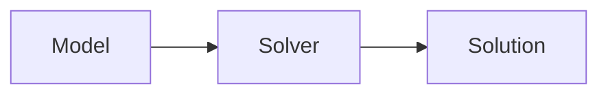

# Content Digest

Turns source material into a **layered digest**: a document the user reads *instead of*
watching or reading the original, at 2–3x the speed, without missing anything they
would have needed from it.

Paths and policies come from the consuming repo's `.claude/wiki-schema.md` (the
configuration table is in `ingest`). This skill reads `wiki_root`, `derived_dir` and
`domains`.

## Where this sits

This skill doesn't acquire sources. Getting material into the wiki (downloading,
transcribing recordings, writing the source page) is `ingest`'s job. This skill starts
from what the wiki already holds and makes something readable from it.

So first check whether the material has been ingested:

- **Already in the wiki:** go straight to Step 1.
- **New sources supplied with the request** (video links, a paper, a deck): run
  `ingest` on each source first and wait for it to finish. It gets any transcript,
  writes the source page, and creates the concept and entity pages. Then come back here.

Don't redo ingest's work by hand, and don't write a second source page for material it
has already filed.

---

## Fidelity rules

Follow the consuming repo's `CLAUDE.md` style guide for voice, sentence construction
and formatting in digest prose. The rules below cover what goes into a digest.

Lectures run at about 130 words per minute; people read at 250 or more. A document that
keeps everything, in order, already saves 2–3x over watching before a single word is
cut. Cutting is where digests lose things, and the speedup doesn't depend on it.

So reproduce worked examples, algorithm traces and formal definitions in full. Never
summarise them. Remove only repetition: restated points, admin announcements, filler.
A long digest is fine as long as its structure lets the reader find their way around.

Three rules follow:

1. **Write paragraphs, and keep bullets for real lists.** Bullet points drop the
   connectives ("we need heuristics *because* blind search blows up here"), and those
   connectives are what let a student answer an exam question they haven't seen
   before. Bullets suit enumerated properties, algorithm steps and options.
2. **Anchor every section.** Each spine section carries slide numbers and a clickable
   timestamp, so any claim the reader doubts is one click from the original. The
   anchors are what make skipping the lecture safe.
3. **Pull out what was only said aloud.** Intuitions, "this trips people up" warnings,
   worked reasoning and exam hints that never made it onto a slide are the only reason
   to watch the recording. Extract them and mark them, and the reader has nothing left
   to watch for.

---

## Pipeline

Work through the steps in order without stopping for confirmation, unless something is
ambiguous enough that a wrong guess would mean rewriting the digest. Show the finished
result, then discuss.

### Step 1: Gather the material

For each digest, establish: the source page(s) in the wiki, the transcript (if the
source was a recording), the slide or paper file, and a label (`l01`, `l02`, … for
lectures; a kebab-case slug otherwise).

One lecture is often **several short videos** plus one deck. Ingest files them as one
source; digest them as one document.

If a transcript exists, `ingest` will have reported where it put it: in the wiki under
`archive-raw`, or in a scratch directory under `link-only`. Read it from there. If the
source page exists but the transcript has been deleted, ask the user instead of
fetching it again; re-running acquisition is ingest's decision.

### Step 2: Read the slides or paper

Use the `pdf` skill to extract text per page. Also **view** any page with a diagram,
state-space figure, algorithm pseudocode or table. In a technical subject those pages
often carry most of the content, and text extraction loses them entirely.

Record, per slide: its number, its title, and what it actually claims. Step 4 needs the
slide numbers for the anchors.

### Step 3: Align the streams

When there are two streams, a recording and a deck, map slide ranges to transcript
spans. Lecturers move through the deck roughly in order, so match on terminology and
worked-example content.

A single-stream source such as a paper has nothing to align. Skip to Step 4 and let the
source's own section structure become the spine.

Classify every piece of material:

| Source | Meaning | Treatment |
|---|---|---|
| Slides only | Formal definitions, notation, pseudocode | Reproduce verbatim; the deck is authoritative |
| Both | The core argument | Spine prose, slide notation + lecturer's explanation |
| Transcript only | Intuitions, asides, warnings, exam hints | Reproduce and **mark** with a `[!mic]` callout |

For a recording, the transcript-only material is what the user can't get from the
slides, so it matters most. Search for it section by section; asides are easy to miss
on a single read-through.

### Step 4: Write the digest

Write `<wiki_root>/<derived_dir>/<label>-<topic-kebab>-digest.md` from the template
below, and link it to the source page `ingest` created.

File the digest as derived material. Ingest already wrote the source page, and a second
page under `sources/` for the same source would break the indexes and the orphan check.
`.claude/wiki-schema.md` defines the frontmatter for the derived section; reread it if
unsure.

### Step 5: Close out

- Add the digest to the relevant `index.md`, following `index_style`, with its
  frontmatter `description` as the entry's one-line description.
- Append to `<wiki_root>/log.md`: `## [YYYY-MM-DD] digest | <label> — <topic>`.
- Cross-link: the digest links to `[[sources/<slug>]]` and to the concept pages ingest
  created, and the source page links back to the digest.
- Run `lint` and fix what it reports.

Don't create concept or entity pages here; `ingest` did that when the source came in.
If the digest turns up concepts ingest missed, tell the user instead of creating the
pages, because it means the ingest was thin and should be fixed there.

Tell the user that `cue-cards` can turn the digest into a spaced-repetition deck, but
don't run it unless they ask.

---

## Digest template

Obsidian-native markdown throughout: callouts, LaTeX, mermaid, tables, footnotes. No
plugins required. Foldable callouts (`-` suffix) hide each answer until clicked, so the
reader has to recall it before seeing it.

````markdown
---
title: <Label> — <Topic>
type: material
source: [[sources/<slug>]]
date: <YYYY-MM-DD>
domain: <required when `domains` is non-empty; omit otherwise>
tags: [<topic>, ...]
status: complete
---

# <Lecture label> — <Topic>

> [!abstract] Orientation — read this first (~1 min)
> **The problem this lecture solves.** One or two sentences: what you couldn't do
> before this material, and what you can do after.
>
> **Core claims**
> 1. …  (5–8 claims, each a full sentence that asserts something, not a topic label)
>
> **Prerequisites.** [[concept]], [[concept]] — what you must already know.
> **Where it sits.** How this follows from the previous lecture and sets up the next.
> **Sources.** N videos (MM min total) + deck (N slides) · **digest read time ~X min**

---

## The Spine

Linear prose in the lecture's own order. Every `###` section anchored:

### <Section title>
`slides 12–18` · [`14:20`](https://www.youtube.com/watch?v=<id>&t=860s)

Tight paragraphs carrying the argument. Formal definitions exactly as the slides state
them, in LaTeX:

$$h(n) \leq h^*(n) \quad \forall n$$

Algorithm pseudocode in full, never paraphrased:

```
function A-STAR(problem, h):
    ...
```

> [!example] Worked example — <name>
> Every step, reproduced in full. In an algorithms subject the trace is what gets
> examined, and a summarised trace can't be followed.

> [!mic] Not on the slides — <timestamp link>
> Lecturer-only material, quoted or closely paraphrased: intuitions, warnings about
> common errors, exam hints. `mic` and `exam` are the only custom callout types here.
> Without the CSS snippet they render as default note callouts, so the digest reads
> fine either way. Everything else in this template is native Obsidian.

Use mermaid where a relationship is structural, such as a pipeline or hierarchy:



Use tables for comparisons across a fixed set of dimensions.

---

## Recall Layer

> [!question]- Question phrased so the answer has to be recalled, not guessed from the wording
> The answer, with a `slides N` / timestamp pointer back to the spine.

8–15 questions covering every core claim. Fold them (`-`) so the answers stay hidden.
Ask *why* and *when does this break* as well as *what is*.

> [!failure] Common failure modes
> Errors this material invites: implication run backwards, a dropped assumption,
> confused notation. Use the lecturer's own warnings where there are any.

> [!exam] Exam surface
> What this lecture is likely to be examined on, and in what form.

> [!todo] Open threads
> What is still unresolved after this lecture: deferred to a later one, stated without
> proof, or unclear in the source. Include anything you couldn't work out from the
> source yourself.

---

## Topics covered

A checklist mapping every slide range to its spine section, so no part of the deck is
dropped without anyone noticing.

- [ ] `slides 1–8` — … → [[#Section]]

## Connections

`See also:` [[concept]], [[sources/<other>.summary]]
````

---

## Quality bar

Before handing off, check:

- [ ] Every spine section has a slide range and a working timestamp link.
- [ ] Every worked example and every piece of pseudocode is complete, not summarised.
- [ ] Every technical term and proper noun is checked against the slides, not the transcript.
- [ ] Transcript-only material is present and marked. If you found none, search again;
      a lecture with nothing said off-slide is rare.
- [ ] Recall questions are foldable and cover every core claim.
- [ ] The topics-covered checklist accounts for every slide in the deck.
- [ ] Formalism renders: `$…$` inline, `$$…$$` block, mermaid fenced.
- [ ] The digest links to its source page, and the source page links back.
- [ ] `lint` passes.

Last check: could the user skip the original, read only this, and lose nothing but
time? Anything that still exists only in the original is a gap to fix before handing
off.
